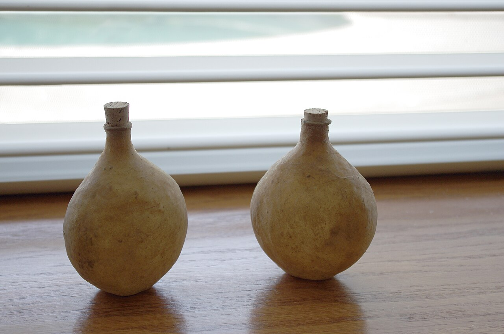

```{=html}
<figure class="cabeza" style="--color:#15171f"><div class="marco"></div><h1>Fragancias</h1></figure>
```

Aquí aprendes a ordenar aromas por cuánto duran, a diluirlos y a cuidar la piel de quien los usa.

## Las palabras que vas a usar



## Lección 1. Por qué cambia un perfume

Cada sustancia se evapora a su paso. Las de mayor presión de vapor se van primero.

:::: {.modelo data-escena="notas"}

::: {.acto}
Tres sustancias recién puestas: limoneno, linalool y vainillina.
:::

::: {.acto}
A las tres vidas medias del limoneno queda 12.5 % de él y cerca de 81 % del linalool.
:::

::: {.acto}
A las 25, del limoneno no queda casi nada y del linalool cerca de 17 %. La vainillina sigue entera. [Laboratorio: notas de un perfume](../laboratorio/notas-de-perfume.qmd).
:::

::::

El modelo toma cada sustancia por separado y no da horas. En una mezcla real también cuentan la piel, el alcohol y los fijadores.

## Lección 2. Construir un acorde

1. Elige un fondo, un corazón y una salida.
2. Pesa gotas en gramos: las gotas cambian de tamaño.
3. Huele en tira de papel a 0, 15 min, 1 h y 4 h. Anota.
4. Cambia una cosa a la vez.

**Ejemplo resuelto.** Un acorde de 10 g con 40 % de naranja lleva 4 g. Si lo diluyes al 12 % en un perfume, la naranja queda en 0.40 × 12 = 4.8 % del producto.

## Lección 3. Concentraciones

Son convenciones del oficio; la ley no las define y las fuentes no coinciden.

| Producto | Fragancia (%) | Alcohol (°) |
|---|---|---|
| Agua de colonia | 3 a 5 | 60 a 80 |
| Agua de toilette | 5 a 10 | 80 a 90 |
| Agua de perfume | 10 a 15 | 85 a 96 |
| Perfume | 15 a 20 | 96 |
| Extracto | más de 20 | 96 |

Si agregas demasiada agua, la fragancia deja de disolverse y se enturbia.

## Lección 4. Lo que puede hacer daño

**Cítricos y sol.** Los límites de IFRA para aceites **exprimidos o prensados en frío**, en productos sin enjuague:

| Aceite | % |
|---|---|
| Bergamota exprimida | 0.40 |
| Lima exprimida | 0.70 |
| Naranja amarga, cáscara exprimida | 1.25 |
| Limón prensado en frío | 2.0 |
| Toronja exprimida | 4.0 |

Los destilados casi no traen furocumarinas y no siguen estos números. Si combinas varios exprimidos, suma la parte que cada uno usa de su límite: el total no pasa de 100 %.

**Ejemplo resuelto.** 0.20 % de bergamota usa 0.20/0.40 = 50 % del límite. 1.0 % de limón usa 1.0/2.0 = 50 %. Juntos llegan a 100 %.

**Oxidación.** El limoneno y el linalool oxidados sensibilizan. En 2900 pacientes, el limoneno oxidado dio 5.2 % de reacciones y el linalool oxidado, 6.9 %. Guarda los aceites llenos, fríos y a oscuras.

**Alérgenos.** El Reglamento (UE) 2023/1545 deja 81 entradas para rotular por encima de 0.001 % sin enjuague o 0.01 % con enjuague. Rige desde el 31-07-2026 para lo que se coloca por primera vez en el mercado.

```{=html}
<figure class="lado"></figure>
```

## Lección 5. Certificado IFRA

El proveedor de una fragancia entrega un certificado con el máximo por tipo de producto. La misma mezcla puede permitir 1 % en un champú y menos en una crema. Sin ese papel no conoces tu límite.

## Qué puedes hacer

```{=html}
<div class="tarjas" data-productos="fragancias"></div>
```

## Comprueba lo que aprendiste

```{=html}
<div data-preguntas="fragancias"></div>
```

## Fuentes

*Dermatocosmética*, EDUCC, ISBN 978-987-626-467-9, cap. 20. IFRA, 51.ª enmienda, estándares 086 a 093. Reglamento (UE) 2023/1545. Presiones de vapor: PubChem, CID 22311, 6549 y 1183. La cifra de 2900 pacientes está en la nota 06 de la investigación.
