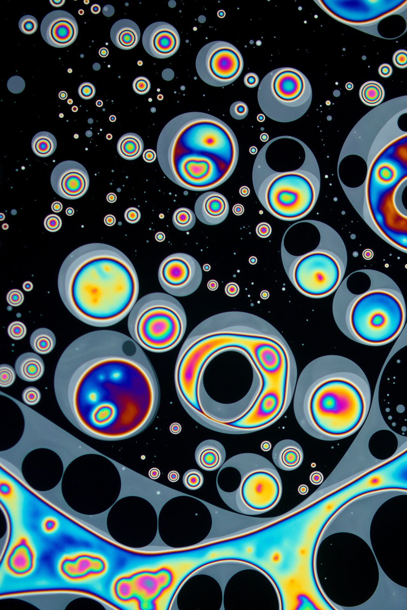

```{=html}
<figure class="cabeza" style="--color:#3f2463"><div class="marco"></div><h1>Emulsiones</h1></figure>
```

Una emulsión reparte gotas de un líquido dentro de otro con el que no se mezcla. Cremas, lociones, bases y máscaras son emulsiones.

## Las palabras que vas a usar



## Lección 1. Quién decide el tipo

Si el aceite queda en gotas, es O/W. Si el agua queda en gotas, es W/O. Decide el emulsionante: la fase donde es más soluble tiende a quedar por fuera (regla de Bancroft). Una fórmula con 75 % de agua puede salir W/O si elegiste un emulsionante lipófilo.

| | O/W | W/O |
|---|---|---|
| Se enjuaga | sí | cuesta |
| Sensación | ligera | más grasa |
| Conduce electricidad | sí | casi nada |
| Ejemplo | loción | base de maquillaje |

## Lección 2. HLB

Griffin ordenó los emulsionantes no iónicos de 0 a 20. Un número bajo significa que aman el aceite; uno alto, que aman el agua.

| HLB | Sirve para |
|---|---|
| 1 a 3 | romper espuma |
| 4 a 6 | emulsión W/O |
| 7 a 9 | mojar superficies |
| 8 a 18 | emulsión O/W |
| 13 a 15 | limpiar |
| 10 a 18 | solubilizar |

Cada aceite pide un HLB. Para una mezcla se promedia por masa. Las tablas no coinciden: la vaselina figura con 10.5 y con 7. Por eso la [calculadora](../calculadoras/hlb.qmd) trabaja con intervalos.

**Ejemplo resuelto.** 12 partes de almendras (6 a 7) y 4 de karité (8): de (12 × 6 + 4 × 8)/16 = 6.5 a (12 × 7 + 4 × 8)/16 = 7.25.

Para ésteres de polioles Griffin usó $HLB = 20(1 - S/A)$, con $S$ el índice de saponificación del éster y $A$ el índice de acidez del ácido graso. Para etoxilados, $HLB = E/5$, con $E$ el porcentaje de óxido de etileno.

El HLB orienta los primeros ensayos y no predice estabilidad. [Laboratorio: balanza de emulsionantes](../laboratorio/balanza-de-emulsionantes.qmd).

## Lección 3. Por qué se separan

:::: {.modelo data-escena="fallas"}

::: {.acto}
Una emulsión estable: gotas repartidas, que se cruzan sin unirse.
:::

::: {.acto}
**Cremado.** Suben por ser más ligeras, y las grandes primero. Al agitar vuelven.
:::

::: {.acto}
**Floculación.** Se agrupan sin fundirse. También vuelven al agitar.
:::

::: {.acto}
**Coalescencia.** Se funden. Ya no hay vuelta.
:::

::: {.acto}
**Maduración de Ostwald.** Las pequeñas se disuelven y alimentan a las grandes, sin tocarse.
:::

::: {.acto}
**Inversión.** El aceite pasa a ser el medio y el agua queda en gotas.
:::

::::

| Falla | Qué ocurre | ¿Vuelve al agitar? |
|---|---|---|
| Cremado o sedimentación | Las gotas suben o bajan por densidad | Sí |
| Floculación | Las gotas se agrupan sin fundirse | Sí |
| Coalescencia | Las gotas se funden | No |
| Maduración de Ostwald | Las grandes crecen a costa de las pequeñas | No |
| Inversión de fases | O/W pasa a W/O o al revés | No |

La [calculadora de Stokes](../calculadoras/stokes.qmd) estima la primera fila. Las demás piden ensayo.

## Lección 4. Por qué más gotas espesan

:::: {.modelo data-escena="cizalla"}

::: {.acto}
Con 20 % de gotas, cada una encuentra por dónde pasar.
:::

::: {.acto}
Con 45 % se estorban, y el mismo esfuerzo mueve menos.
:::

::: {.acto}
Cerca del empaque máximo casi no fluye. Krieger y Dougherty lo escribieron así, con $\phi$ la fracción de gotas:

$$\frac{\eta}{\eta_0} = \left(1 - \frac{\phi}{\phi_m}\right)^{-2.5\,\phi_m}$$

[Laboratorio: viscosidad de una emulsión](../laboratorio/viscosidad-de-una-emulsion.qmd).
:::

::::

Es un modelo de esferas rígidas; una gota líquida se deforma y estorba menos.

## Lección 5. Hacerla

1. Calienta las dos fases por separado, unos grados sobre la cera que funde más alto, a la misma temperatura.
2. Agrega la fase interna sobre la externa con agitación intensa.
3. Agita hasta enfriar. Si dejas de agitar, las ceras cristalizan en granos.
4. Agrega lo sensible al calor por debajo de 40 °C.

En frío se ahorra energía, pero no sirve con ceras.

## Lección 6. Saber qué tipo obtuviste

1. Agrega un colorante hidrosoluble y mira al microscopio. Fondo coloreado: O/W. Gotas coloreadas: W/O.
2. Diluye una muestra. La emulsión acepta su fase externa y se rompe con la interna.
3. Mide la conductividad. Una O/W conduce; una W/O casi no.

Haz dos de las tres: una sola puede engañar.

## Comprueba lo que aprendiste

```{=html}
<div data-preguntas="emulsiones"></div>
```

## Fuentes

Griffin 1949, *J. Soc. Cosmet. Chem.* 1:311 (sin DOI). Griffin 1954, 5:249 (sin DOI). Salager et al. 2020, DOI [10.3390/cosmetics7030057](https://doi.org/10.3390/cosmetics7030057). Krieger y Dougherty 1959, DOI [10.1122/1.548848](https://doi.org/10.1122/1.548848). Baki 2023, ISBN 978-1-119-70977-0, pp. 52-53, 69-72, 213-215 y 260.
