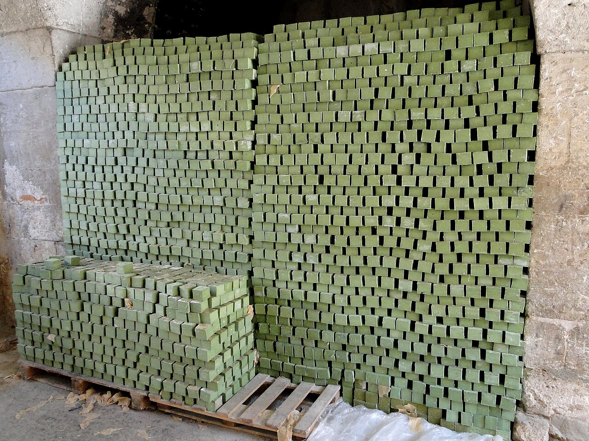

```{=html}
<figure class="cabeza" style="--color:#4d5a2c"><div class="marco"></div><h1>Limpieza</h1></figure>
```

## Jabón

Un aceite y una base forman jabón y glicerina. El índice de saponificación (SAP) dice cuánta base pide cada aceite:

$$m_{NaOH} = \sum \frac{m_i\,SAP_i}{1000}\cdot\frac{40.00}{56.11}\,(1 - s)$$

donde $s$ es el sobreengrase. Calcula el tuyo en [jabón](../calculadoras/jabon.qmd).

:::: {.modelo data-escena="jabon"}

::: {.acto}
Una grasa es glicerina con tres cadenas.
:::

::: {.acto}
Llega la lejía: una base por cadena.
:::

::: {.acto}
Quedan tres jabones y una glicerina.
:::

::: {.acto}
El jabón mete la cola en la grasa y deja la cabeza en el agua. Así la arrastra.
:::

::::

Dureza, limpieza y cremosidad, como las dan las calculadoras populares, son sumas de ácidos grasos. Son convenciones. El SAP y el índice de yodo sí se miden con método normalizado.

El pH de una solución de jabón figura entre 9.5 y 11.0 según la página del mismo texto. Un syndet queda cerca de 7, o de 5.5 según su tensioactivo.

## Gel de ducha y champú

El tensioactivo comercial viene diluido. Para saber cuánto pesar usa [materia activa](../calculadoras/activa.qmd).

| Tipo | Papel | Ejemplo |
|---|---|---|
| Aniónico | limpia y hace espuma | Sodium Laureth Sulfate |
| Anfótero | suaviza y sostiene la espuma | Cocamidopropyl Betaine |
| No iónico | suaviza y solubiliza | Decyl Glucoside |
| Catiónico | acondiciona | Cetrimonium Chloride |

## De sueltos a micelas

:::: {.modelo data-escena="micelas"}

::: {.acto}
Con poco tensioactivo, cada molécula anda suelta.
:::

::: {.acto}
Pasada la concentración micelar crítica, las que sobran se juntan: colas adentro, cabezas afuera.
:::

::: {.acto}
Con sal, la CMC baja. La misma cantidad arma más micelas: con NaCl 0.10 M, la CMC del dodecilsulfato de sodio pasa de unos 8.2 a 1.49 mM.
:::

::: {.acto}
Mueve la cantidad y la CMC.

[Abrir el laboratorio](../laboratorio/sal-y-micelas.qmd): cuánta sal hace falta.

[Abrir el laboratorio](../laboratorio/activo-de-un-champu.qmd): cuánto tensioactivo pesar.
:::

::::

## Por qué la sal espesa y luego adelgaza

La sal reduce la repulsión entre cabezas, las micelas crecen y se enredan. Pasado un máximo se ramifican y la viscosidad cae. Traza tu curva con varias concentraciones de NaCl antes de fijar una.

La concentración micelar crítica del dodecilsulfato de sodio a 25 °C es de 8.06 a 8.4 mM. Con NaCl 0.10 M baja a 1.49 mM.

## Referencias

Codex CXS 210-1999 (ed. 2015). Baki 2023, ISBN 978-1-119-70977-0, pp. 191-203. Mukerjee y Mysels 1971, DOI [10.6028/NBS.NSRDS.36](https://doi.org/10.6028/NBS.NSRDS.36).
