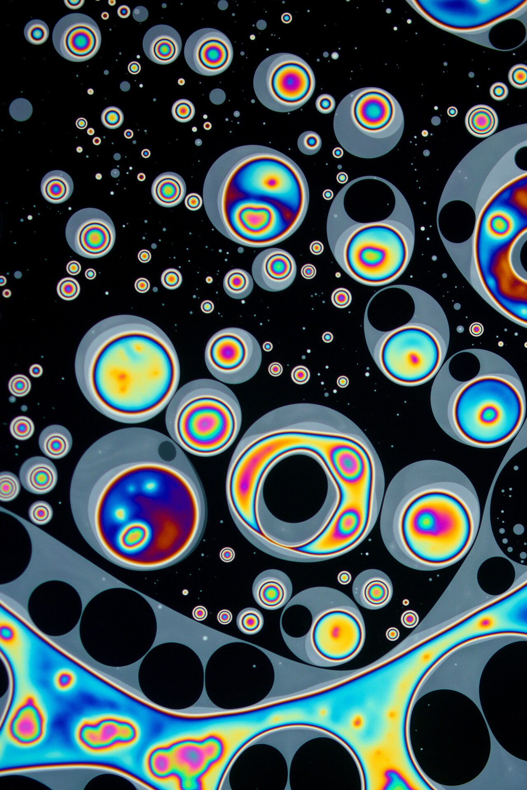

```{=html}
<figure class="cabeza cinta" style="--color:#3f2463"><div class="marco"></div><h1>De dónde salen las fórmulas</h1></figure>
```

:::: {.modelo data-escena="stokes" data-pieza="stokes" data-nombre="Ley de Stokes" style="--c:#3f2463"}

## ¿Por qué crema una emulsión?

::: {.acto}
Una gota de aceite dentro del agua es más ligera que el agua que desplaza. Mírala desde la propia gota: es el líquido el que pasa a su alrededor.

Mueve el radio, o tira del borde de la gota con el ratón.
:::

::: {.acto}
Si hay diferencia de densidades, el agua empuja la gota hacia arriba. El empuje neto crece con el volumen, es decir, con $r^3$:

$$F_{empuje} = \tfrac{4}{3}\pi r^3 (\rho_{medio} - \rho_{gota})\, g$$
:::

::: {.acto}
Al moverse, el líquido la frena. El arrastre crece con la velocidad:

$$F_{arrastre} = 6 \pi \eta r v$$

En un instante las dos flechas miden lo mismo y la velocidad ya no cambia. Al igualarlas y despejar $v$:

$$v = \frac{2 r^2 (\rho_{medio} - \rho_{gota})\, g}{9 \eta}$$
:::

::: {.acto}
El radio entra al cuadrado. La gota de radio $2r$ recorre cuatro espacios mientras la de radio $r$ recorre uno. Por eso homogeneizar ayuda tanto.

El recorrido es $x = v\,t$. El programa pasa micrómetros a metros y días a segundos, con $g = 9.80665\ \mathrm{m/s^2}$.

**Cuándo falla.** Con gotas concentradas, medios con esfuerzo de fluencia o gotas que se funden. Una crema espesada puede no cremar aunque la ecuación dé un número.

[Abrir el laboratorio](laboratorio/cremado.qmd) o [la calculadora](calculadoras/stokes.qmd).
:::

::::

:::: {.modelo data-escena="acido" data-pieza="acido" data-nombre="Henderson-Hasselbalch" style="--c:#00616f"}

## ¿Cuánto conservante queda activo?

::: {.acto}
Cada bola amarilla es una molécula entera del ácido, $HA$; el punto blanco es su protón. A pH bajo casi todas lo conservan.

$$HA \rightleftharpoons H^+ + A^-$$
:::

::: {.acto}
Al subir el pH, más moléculas lo sueltan. La constante de acidez fija el reparto:

$$K_a = \frac{[H^+][A^-]}{[HA]}$$

Cuando el pH iguala al $pK_a$, aquí 4.76, la mitad está entera. Fíjate en que no paran: unas sueltan el protón y otras lo recuperan.
:::

::: {.acto}
Al tomar logaritmos queda $pH - pK_a = \log_{10}([A^-]/[HA])$. La fracción entera es $[HA]$ entre el total:

$$f = \frac{[HA]}{[HA] + [A^-]} = \frac{1}{1 + 10^{\,pH - pK_a}}$$

Una unidad por encima del $pK_a$ queda 1/11, cerca de 9 %. Ahí salta el aviso del laboratorio.
:::

::: {.acto}
Ahora mueve tú el pH.

**Cuándo falla.** Con ácidos de varios protones, sales concentradas o aceite que se lleva parte del ácido.

[Abrir el laboratorio](laboratorio/conservante-y-ph.qmd) o [la calculadora](calculadoras/conservante.qmd).
:::

::::

:::: {.modelo data-escena="jabon" data-pieza="jabon" data-nombre="Saponificación" style="--c:#4d5a2c"}

## ¿Cuánta lejía pide un aceite?

::: {.acto}
Una grasa es glicerina con tres cadenas de ácido graso.
:::

::: {.acto}
Cada cadena necesita una base. El SAP dice cuántos miligramos de KOH saponifican un gramo de aceite. Un mol de NaOH reemplaza a un mol de KOH, así que se pasa de uno a otro con sus masas molares, 40.00 y 56.11.
:::

::: {.acto}
Salen tres jabones y una glicerina. Para una mezcla de aceites se suma lo que pide cada uno:

$$m_{base} = \sum_i \frac{m_i\,SAP_i}{1000}\; k\;(1 - s)\;\frac{1}{p}$$

con $k = 40.00/56.11$ para NaOH y $k = 1$ para KOH, $s$ el sobreengrase y $p$ la pureza, en fracción. El agua de una lejía de concentración $c$ es $m_{base}(1 - c)/c$.
:::

::: {.acto}
El jabón limpia porque su cola entra en la grasa y su cabeza se queda en el agua.

[Abrir la calculadora](calculadoras/jabon.qmd).
:::

::::

:::: {.modelo data-escena="hlb" data-pieza="hlb" data-nombre="HLB" style="--c:#9a4320"}

## ¿Qué mezcla de emulsionantes?

::: {.acto}
El HLB de una mezcla es un promedio por masa. Un promedio por masa es un centro de gravedad, así que cabe en una balanza. El apoyo está en el HLB que pide el aceite. Con 80 % de Span 80, se inclina.
:::

::: {.acto}
Para equilibrarla se despeja la fracción de A:

$$HLB = x_A HLB_A + (1 - x_A) HLB_B$$

$$x_A = \frac{HLB_B - HLB}{HLB_B - HLB_A}$$

Para HLB 10 salen 46.7 % de Span 80 y 53.3 % de Tween 80. El HLB que pide la fase aceitosa se calcula igual, $\sum w_i\,HLB_i$. Es una regla empírica de Griffin.

[Abrir la calculadora](calculadoras/hlb.qmd).
:::

::::

:::: {.modelo data-escena="activa" data-pieza="activa" data-nombre="Materia activa" style="--c:#5c1f3a"}

## ¿Cuánta materia prima pesas?

::: {.acto}
Un tensioactivo comercial ya viene con agua. Los puntos blancos son la parte activa.
:::

::: {.acto}
Agregas agua hasta completar el lote. El vaso sube y los puntos son los mismos.
:::

::: {.acto}
Es un balance de masa: el activo que pesas es el que queda.

$$m_{prima} = \frac{m_{lote}\; c_{final}}{c_{comercial}}$$

[Abrir la calculadora](calculadoras/activa.qmd).
:::

::::

## Los laboratorios que armes tú

La ficha dibuja el circuito de tus bloques y escribe sus ecuaciones. La curva evalúa tu ecuación en 101 puntos entre el mínimo y el máximo del control. En la probeta, el recorrido sale de Stokes y se detiene en 100 mm; el tamaño, el color, la posición inicial y el grosor de la capa son dibujo. Agrega con **supuesto del modelo** lo que tu ecuación da por cierto y con **fuente** de dónde salió.

## Comprobaciones y referencias

El motor trae pruebas con casos resueltos a mano: Stokes y su dependencia con $r^2$, la fracción 0.5 a $pH = pK_a$, Span 80 con Tween 80 a HLB 10, 500 g de oliva con 64.3 g de NaOH, y SLES al 8 %.

Baki 2023, *Introduction to Cosmetic Formulation and Technology*, ISBN 978-1-119-70977-0, p. 71, para la ley de Stokes en emulsiones. Griffin 1949, *J. Soc. Cosmet. Chem.* 1:311, y 1954, 5:249 (sin DOI). pKa: PubChem, CID 243 y 643460. SAP: Codex CXS 210-1999, CXS 33 y CXS 211. Las deducciones son las de los textos de fisicoquímica y balance de masa.
