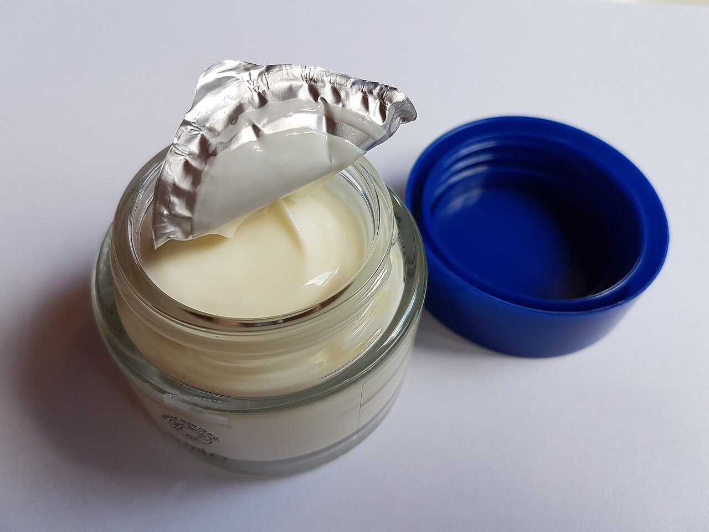

```{=html}
<figure class="cabeza" style="--color:#b3245c" data-alto="baja"><div class="marco"></div><h1>Bálsamo labial</h1></figure>
```

[Cuidado de la piel](../piel/index.qmd). Red cristalina de ceras que retiene aceite. Forma: anhidro sólido.

Las recetas son propuestas de este proyecto y **están sin ensayar**. Se presentan como hipótesis de trabajo para contrastar en el laboratorio.

## Bálsamo labial clásico

```{=html}
<div data-receta="balsamo-labial-clasico"><p>Cargando.</p></div>
```

::: {.avisos}
- Sistema anhidro, sin conservante.
- Contiene aceite de frutos secos.
:::

### Fundamento

La cera cristaliza en una red que retiene el aceite por capilaridad. La relación cera a aceite fija la dureza; el ricino, polar y viscoso, aporta brillo y adherencia.

### Procedimiento

1. Pesar todo menos la fase C y fundirlo en baño de agua a 75 °C.
2. Mezclar hasta que no se observen restos sólidos.
3. Retirar del calor y esperar a que baje unos 10 °C.
4. Agregar la fase C y mezclar.
5. Verter en el envase caliente y dejar enfriar sin moverlo. Rotular lote y fecha.

### Control de calidad

| Determinación | Especificación | Método |
|---|---|---|
| Aspecto | liso, sin granos ni gotas de aceite | a 24 h y a 7 días |
| Dureza | registrar la penetración | aguja o peso conocido |
| Punto de fusión | registrar el intervalo | capilar o baño con termómetro |
| Calor | sin gotas en la superficie | 40 °C, 7 días |
| Olor | sin rancio | a 1 y a 3 meses |

### Diagnóstico de fallas

| Observación | Causa probable | Acción correctiva |
|---|---|---|
| Granos | enfrió despacio o la manteca cristalizó mal | fundir otra vez y enfriar más rápido |
| Exudación de aceite | poca cera o demasiado aceite líquido | aumentar la cera de 1 en 1 % |
| Fractura | demasiada cera dura | reducir la cera y aumentar el aceite |
| Olor rancio | oxidación | usar aceite fresco, tocoferol y envase lleno |

### Variables de estudio

- Cera a 18 % para un tarro, a 25 % para una barra en clima cálido.
- Sustituir almendras por girasol si hay alergia.

**Referencias.** Método y proceso: Baki 2023, ISBN 978-1-119-70977-0, pp. 72 y 250-259. Proporciones propuestas en este proyecto.

## Otros productos de esta sección

[Loción corporal](locion-corporal.qmd), [Crema corporal](crema-corporal.qmd), [Crema facial](crema-facial.qmd), [Crema de manos](crema-de-manos.qmd), [Gel hidratante](gel-hidratante.qmd), [Sérum](serum.qmd), [Aceite corporal](aceite-corporal.qmd), [Ungüento](unguento.qmd), [Manteca batida](manteca-batida.qmd), [Exfoliante](exfoliante.qmd), [Mascarilla de arcilla](mascarilla.qmd).
