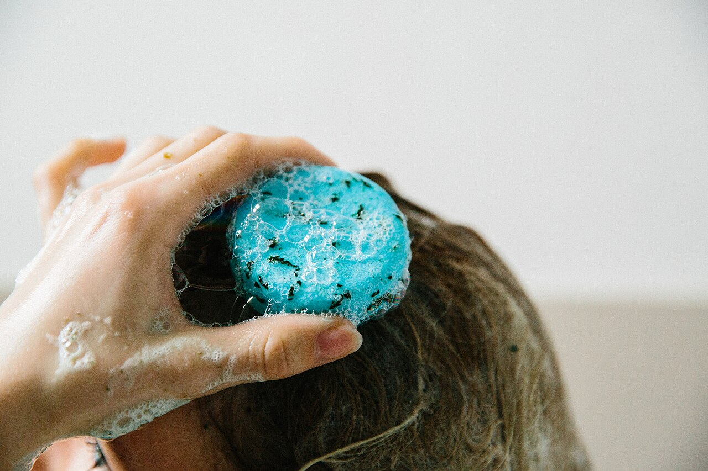

```{=html}
<figure class="cabeza" style="--color:#00616f" data-alto="baja"><div class="marco"></div><h1>Champú</h1></figure>
```

[Cabello](../cabello/index.qmd). Sistema aniónico y anfótero con depósito por coacervación. Forma: solución espesada.

Las recetas son propuestas de este proyecto y **están sin ensayar**. Se presentan como hipótesis de trabajo para contrastar en el laboratorio.

## Champú clásico

```{=html}
<div data-receta="champu-clasico"><p>Cargando.</p></div>
```

::: {.avisos}
- Contiene agua. Sin ensayo del conservante puede contaminarse sin cambios visibles.
- No se aplica en la piel sin control microbiológico y evaluación de seguridad.
:::

### Fundamento

La fórmula contiene 9 % de SLES y 3 % de betaína como activo. Al enjuagar, la dilución separa un coacervado de poliquaternio y tensioactivo que se deposita en la fibra.

### Procedimiento

1. Pesar el agua y disolver lo que pide la fase A.
2. Agregar los tensioactivos por la pared del vaso, con agitación lenta para no hacer espuma.
3. Agregar la fase C.
4. Medir el pH y ajustarlo. Los glucósidos llegan a pH 11 o 12: bajarlo antes de juzgar la viscosidad.
5. Si lleva sal, disolverla en un poco de agua y agregarla en pasos de 0.2 %. Detenerse al alcanzar la viscosidad buscada.
6. Dejar reposar 24 h y envasar.

### Control de calidad

| Determinación | Especificación | Método |
|---|---|---|
| pH | el de la receta ± 0.3 | medidor |
| Viscosidad | registrar husillo, rpm y temperatura | viscosímetro o copa |
| Espuma | altura a 0, 1 y 5 min | probeta agitada, solución al 1 % |
| Aspecto | sin turbidez nueva | 4 °C, ambiente y 40 °C |
| Microbiología | sin crecimiento | placas a t0 y a 28 días |

### Diagnóstico de fallas

| Observación | Causa probable | Acción correctiva |
|---|---|---|
| No espesa | poca sal o pH alto | ajustar el pH y seguir la curva de sal |
| Perdió viscosidad al agregar sal | se superó el máximo de la curva | diluir con más tensioactivo: con sal no se recupera |
| Se enturbia en frío | fragancia o fase que no se disuelve | reducir la fragancia o usar un solubilizante |

### Variables de estudio

- Curva de sal de 0.4 a 1.4 %.
- Sin poliquaternio para cabello fino.

**Referencias.** Tensioactivos: Thompson et al. 2023 y catálogos de proveedor citados en la calculadora de materia activa. Límites: Reglamento (CE) 1223/2009, anexos según CosIng, exportación del 13-11-2026.

## Champú suave sin sulfatos

```{=html}
<div data-receta="champu-suave"><p>Cargando.</p></div>
```

::: {.avisos}
- Contiene agua. Sin ensayo del conservante puede contaminarse sin cambios visibles.
- No se aplica en la piel sin control microbiológico y evaluación de seguridad.
- El pH determina la actividad del conservante.
:::

### Fundamento

El alquil glucósido carece de carga y no responde al electrolito, de modo que se espesa con goma. No hay datos publicados que demuestren menor daño capilar de un champú sin sulfatos.

### Procedimiento

1. Pesar el agua y disolver lo que pide la fase A.
2. Agregar los tensioactivos por la pared del vaso, con agitación lenta para no hacer espuma.
3. Agregar la fase C.
4. Medir el pH y ajustarlo. Los glucósidos llegan a pH 11 o 12: bajarlo antes de juzgar la viscosidad.
5. Si lleva sal, disolverla en un poco de agua y agregarla en pasos de 0.2 %. Detenerse al alcanzar la viscosidad buscada.
6. Dejar reposar 24 h y envasar.

### Control de calidad

| Determinación | Especificación | Método |
|---|---|---|
| pH | el de la receta ± 0.3 | medidor |
| Viscosidad | registrar husillo, rpm y temperatura | viscosímetro o copa |
| Espuma | altura a 0, 1 y 5 min | probeta agitada, solución al 1 % |
| Aspecto | sin turbidez nueva | 4 °C, ambiente y 40 °C |
| Microbiología | sin crecimiento | placas a t0 y a 28 días |

### Diagnóstico de fallas

| Observación | Causa probable | Acción correctiva |
|---|---|---|
| No espesa | poca sal o pH alto | ajustar el pH y seguir la curva de sal |
| Perdió viscosidad al agregar sal | se superó el máximo de la curva | diluir con más tensioactivo: con sal no se recupera |
| Se enturbia en frío | fragancia o fase que no se disuelve | reducir la fragancia o usar un solubilizante |

### Variables de estudio

- Goma a 1 % si queda líquido.
- Agregar 0.5 % de pantenol.

**Referencias.** Tensioactivos: Thompson et al. 2023 y catálogos de proveedor citados en la calculadora de materia activa. pKa: PubChem, CID 243 y 643460. Límites: Reglamento (CE) 1223/2009, anexos según CosIng, exportación del 13-11-2026.

## Otros productos de esta sección

[Champú sólido](champu-solido.qmd), [Acondicionador](acondicionador.qmd), [Mascarilla capilar](mascarilla-capilar.qmd), [Crema para peinar](crema-para-peinar.qmd), [Aceite capilar](aceite-capilar.qmd), [Gel fijador](gel-fijador.qmd).
