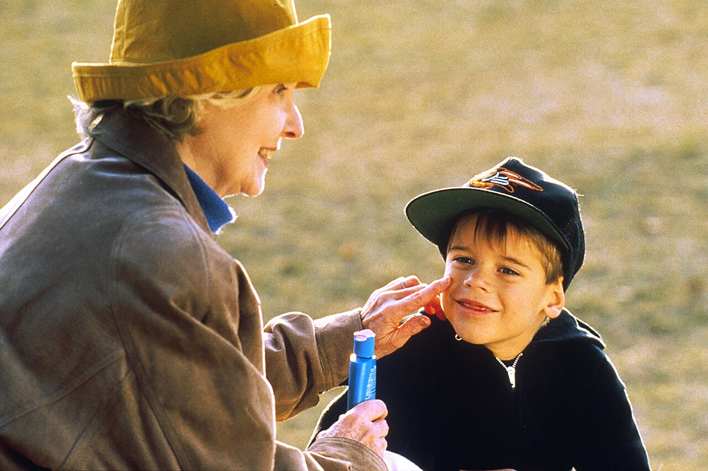

```{=html}
<figure class="cabeza" style="--color:#8a5200" data-alto="baja"><div class="marco"></div><h1>Loción para después del sol</h1></figure>
```

[Protección solar](../solar/index.qmd). Humectante con película ligera, sin fragancia. Forma: emulsión O/W.

Las recetas son propuestas de este proyecto y **están sin ensayar**. Se presentan como hipótesis de trabajo para contrastar en el laboratorio.

## Loción para después del sol

```{=html}
<div data-receta="locion-despues-del-sol"><p>Cargando.</p></div>
```

::: {.avisos}
- Contiene agua. Sin ensayo del conservante puede contaminarse sin cambios visibles.
- No se aplica en la piel sin control microbiológico y evaluación de seguridad.
- No protege del sol.
:::

### Fundamento

Aporta agua, humectante y una película ligera. Se omite la fragancia porque la piel irritada tolera menos los alérgenos.

### Procedimiento

1. Pesar la fase A. Si lleva goma, mezclarla primero con la glicerina; después agregar el agua y agitar hasta que no queden grumos.
2. Pesar la fase B en otro vaso.
3. Calentar A y B en baño de agua hasta 72 °C y mantenerlas 10 min. Reponer con agua caliente lo que se evaporó de A.
4. Verter B sobre A con el agitador encendido y homogeneizar 3 min.
5. Reducir la velocidad y seguir agitando hasta 40 °C.
6. Agregar la fase C y mezclar 2 min.
7. Medir el pH y ajustarlo gota a gota con ácido cítrico o sosa, los dos al 10 %.
8. Pesar el lote final, completar con agua hasta el total y envasar. Rotular lote y fecha.

### Control de calidad

| Determinación | Especificación | Método |
|---|---|---|
| pH | el de la receta ± 0.3 | medidor calibrado o tiras |
| Tipo de emulsión | O/W | gota en agua: debe dispersarse. Confirmar con conductividad o colorante hidrosoluble al microscopio |
| Aspecto | homogéneo, sin granos | extender una capa fina sobre vidrio |
| Centrífuga | sin separación | 3000 rpm, 30 min |
| Ciclos | sin separación ni cambio de olor | de tres a seis ciclos entre −10 y 40 °C, 24 h por etapa |
| Microbiología | sin crecimiento | placas a t0 y a 28 días; ensayo de eficacia del conservante antes de su uso |

### Diagnóstico de fallas

| Observación | Causa probable | Acción correctiva |
|---|---|---|
| Se separa una capa de aceite y vuelve al agitar | cremado: gotas grandes o medio poco viscoso | homogeneizar más tiempo o aumentar un poco la goma |
| Se separa y no vuelve | coalescencia: falta emulsionante o el par no es el adecuado | probar otro HLB antes de subir la dosis |
| Queda granosa | las ceras cristalizaron o las fases estaban a distinta temperatura | igualar temperaturas y enfriar agitando |
| No se dispersa en agua | salió W/O | aumentar la parte hidrófila del emulsionante |
| Olor o moho | conservante débil o pH alto | descartarla, revisar pH y conservante |

### Variables de estudio

- Aumentar la glicerina a 7 %.

**Referencias.** Método y proceso: Baki 2023, ISBN 978-1-119-70977-0, pp. 72 y 250-259. Límites: Reglamento (CE) 1223/2009, anexos según CosIng, exportación del 13-11-2026.

## Otros productos de esta sección

[Gel para después del sol](gel-despues-del-sol.qmd), [Muestra mineral](muestra-mineral.qmd).
