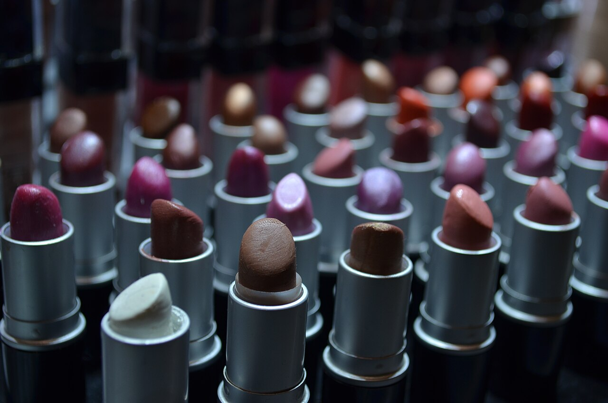

```{=html}
<figure class="cabeza" style="--color:#5c1f3a" data-alto="baja"><div class="marco"></div><h1>Máscara de pestañas</h1></figure>
```

[Maquillaje](../maquillaje/index.qmd). Emulsión con jabón formado in situ, cera y óxido negro. Forma: emulsión con cera.

Las recetas son propuestas de este proyecto y **están sin ensayar**. Se presentan como hipótesis de trabajo para contrastar en el laboratorio.

## Máscara de pestañas

```{=html}
<div data-receta="mascara-de-pestanas"><p>Cargando.</p></div>
```

::: {.avisos}
- Contiene agua. Sin ensayo del conservante puede contaminarse sin cambios visibles.
- Zona ocular: exige recuento con límite de 100 UFC/g y colorantes permitidos.
- No se aplica en la piel sin control microbiológico y evaluación de seguridad.
:::

### Fundamento

El jabón emulsionante se forma in situ. La cera aumenta el grosor aparente de la pestaña y el polímero fija el pigmento.

### Procedimiento

1. Hidratar la hidroxietilcelulosa en el agua y agregar el copolímero y la trietanolamina.
2. Dispersar el óxido negro en esa fase y moler.
3. Fundir la fase B a 88 °C y llevar A a la misma temperatura.
4. Verter B sobre A con agitación fuerte: el esteárico y la trietanolamina forman el emulsionante en ese momento.
5. Enfriar agitando hasta 40 °C y agregar la fase C.
6. Envasar en tubo limpio con cepillo nuevo.

### Control de calidad

| Determinación | Especificación | Método |
|---|---|---|
| pH | el de la receta ± 0.3 | medidor calibrado o tiras |
| Tipo de emulsión | O/W | gota en agua: debe dispersarse. Confirmar con conductividad o colorante hidrosoluble al microscopio |
| Aspecto | homogéneo, sin granos | extender una capa fina sobre vidrio |
| Centrífuga | sin separación | 3000 rpm, 30 min |
| Ciclos | sin separación ni cambio de olor | de tres a seis ciclos entre −10 y 40 °C, 24 h por etapa |
| Microbiología | sin crecimiento | placas a t0 y a 28 días; ensayo de eficacia del conservante antes de su uso |

### Diagnóstico de fallas

| Observación | Causa probable | Acción correctiva |
|---|---|---|
| Se separa una capa de aceite y vuelve al agitar | cremado: gotas grandes o medio poco viscoso | homogeneizar más tiempo o aumentar un poco la goma |
| Se separa y no vuelve | coalescencia: falta emulsionante o el par no es el adecuado | probar otro HLB antes de subir la dosis |
| Queda granosa | las ceras cristalizaron o las fases estaban a distinta temperatura | igualar temperaturas y enfriar agitando |
| No se dispersa en agua | salió W/O | aumentar la parte hidrófila del emulsionante |
| Olor o moho | conservante débil o pH alto | descartarla, revisar pH y conservante |

### Variables de estudio

- Carnauba a 2 % si queda dura.
- Óxido a 7 % para un tono suave.

**Referencias.** Grupos y rangos: fórmula de proveedor analizada en la nota 05; proporciones propias. Higiene: Giacomel et al. 2013, DOI 10.1111/ics.12053. Límites: Reglamento (CE) 1223/2009, anexos según CosIng, exportación del 13-11-2026.

## Otros productos de esta sección

[Labial](labial.qmd), [Brillo labial](brillo-labial.qmd), [Polvo compacto](polvo-compacto.qmd), [Rubor](rubor.qmd), [Sombra de ojos](sombra.qmd), [Base fluida](base.qmd).
