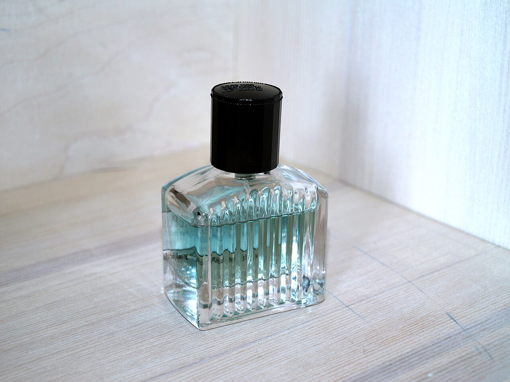

```{=html}
<figure class="cabeza" style="--color:#15171f" data-alto="baja"><div class="marco"></div><h1>Perfume sólido</h1></figure>
```

[Fragancias](../fragancias/index.qmd). Fragancia retenida en una red de cera. Forma: anhidro sólido.

Las recetas son propuestas de este proyecto y **están sin ensayar**. Se presentan como hipótesis de trabajo para contrastar en el laboratorio.

## Perfume sólido

```{=html}
<div data-receta="perfume-solido"><p>Cargando.</p></div>
```

::: {.avisos}
- Verificar el certificado IFRA de la fragancia.
:::

### Fundamento

La red de cera retarda la difusión de los volátiles. La fragancia se incorpora por debajo de 60 °C para limitar la pérdida de la salida.

### Procedimiento

1. Pesar todo menos la fase C y fundirlo en baño de agua a 75 °C.
2. Mezclar hasta que no se observen restos sólidos.
3. Retirar del calor y esperar a que baje unos 10 °C.
4. Agregar la fase C y mezclar.
5. Verter en el envase caliente y dejar enfriar sin moverlo. Rotular lote y fecha.

### Control de calidad

| Determinación | Especificación | Método |
|---|---|---|
| Aspecto | liso, sin granos ni gotas de aceite | a 24 h y a 7 días |
| Dureza | registrar la penetración | aguja o peso conocido |
| Punto de fusión | registrar el intervalo | capilar o baño con termómetro |
| Calor | sin gotas en la superficie | 40 °C, 7 días |
| Olor | sin rancio | a 1 y a 3 meses |

### Diagnóstico de fallas

| Observación | Causa probable | Acción correctiva |
|---|---|---|
| Granos | enfrió despacio o la manteca cristalizó mal | fundir otra vez y enfriar más rápido |
| Exudación de aceite | poca cera o demasiado aceite líquido | aumentar la cera de 1 en 1 % |
| Fractura | demasiada cera dura | reducir la cera y aumentar el aceite |
| Olor rancio | oxidación | usar aceite fresco, tocoferol y envase lleno |

### Variables de estudio

- Cera a 24 % si queda dura.

**Referencias.** Proporciones propuestas en este proyecto. IFRA, 51.ª enmienda.

## Otros productos de esta sección

[Acorde](acorde.qmd), [Agua de colonia](colonia.qmd), [Agua de perfume](agua-de-perfume.qmd), [Perfume en aceite](perfume-en-aceite.qmd), [Bruma corporal](bruma.qmd).
